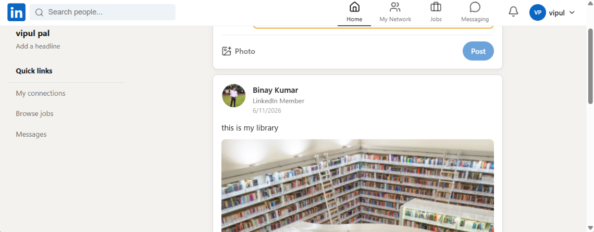
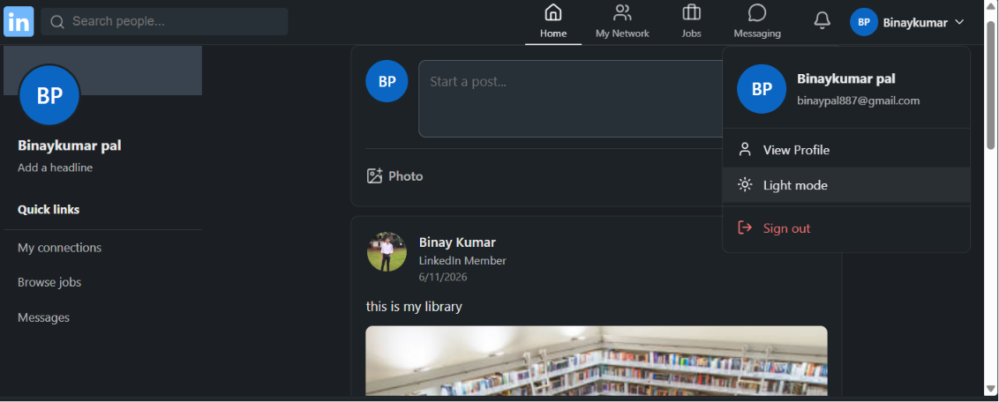
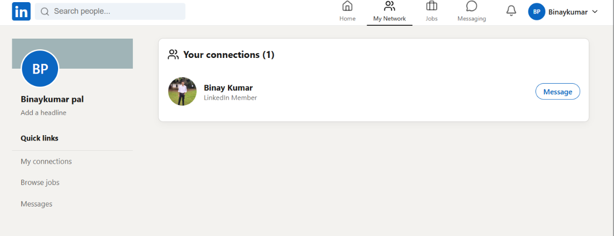
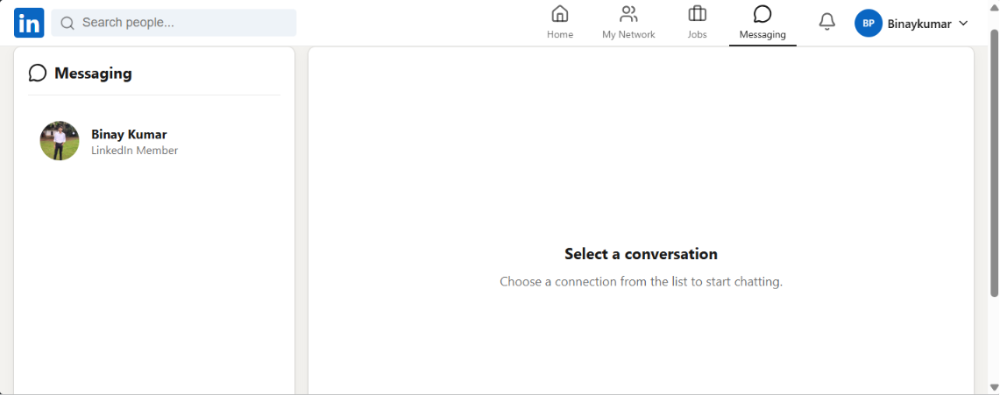

<div align="center">


<br/>


<br/>

> **A production-grade, full-stack LinkedIn-inspired professional networking platform** — built with the MERN Stack, featuring real-time messaging, job boards, connection graphs, and JWT-secured authentication.

<br/>
• [📖 Docs](#api-endpoints) • [🐛 Report Bug](https://github.com/Binay0018/linkedin-clone/issues) • [✨ Request Feature](https://github.com/Binay0018/linkedin-clone/issues)

</div>

---

## 📌 Table of Contents

- [About the Project](#-about-the-project)
- [Features](#-features)
- [Tech Stack](#-tech-stack)
- [Architecture](#-system-architecture)
- [Project Structure](#-project-structure)
- [Getting Started](#-getting-started)
- [API Endpoints](#-api-endpoints)
- [Screenshots](#-screenshots)
- [Performance & Security](#-performance--security)
- [Future Enhancements](#-future-enhancements)
- [Contributing](#-contributing)
- [License](#-license)

---

## 🧭 About the Project

LinkedIn Clone is not just a UI replica — it's a **fully functional professional networking platform** with a complete backend API, real-time WebSocket communication, cloud image storage, and industry-standard security practices. This project was built to demonstrate **production-level full-stack engineering** skills across authentication, scalable REST APIs, real-time systems, and cloud integration.

### 🎯 What makes this different?
- ⚡ **Socket.io** for real-time chat, notifications & typing indicators
- ☁️ **Cloudinary** for optimized cloud image storage
- 🔐 **JWT with refresh tokens** — not just simple login
- 📧 **Nodemailer** for email verification & password reset flows
- 🛡️ **Production security** — rate limiting, Helmet, XSS & NoSQL injection protection
- 📄 **Paginated feed** with loading skeletons for smooth UX

---

## ✨ Features

<details>
<summary><strong>🔐 Authentication & Security</strong></summary>
<br/>

| Feature | Details |
|---|---|
| Registration & Login | Full sign-up/sign-in flow with validation |
| JWT Auth | Access token (15 min) + Refresh token strategy |
| Protected Routes | Middleware-guarded private routes |
| Password Security | bcrypt hashing with salt rounds |
| Email Verification | Nodemailer-powered verification emails |
| Password Reset | Secure token-based reset link via email |
| Rate Limiting | Brute-force protection on auth endpoints |
| Security Headers | Helmet.js for HTTP headers hardening |
| XSS Protection | Input sanitization against cross-site scripting |
| NoSQL Injection Guard | Mongoose query sanitization |

</details>

<details>
<summary><strong>👤 User Profiles</strong></summary>
<br/>

- Create and update professional profiles
- Upload & manage profile pictures via **Cloudinary**
- Professional headline, bio, and summary
- Skills tagging and experience timeline
- Education history management
- Public profile visibility

</details>

<details>
<summary><strong>📰 Feed & Posts</strong></summary>
<br/>

- Create rich text & image posts
- Paginated feed with infinite scroll
- Like / Unlike posts with real-time count
- Nested commenting system
- Loading skeletons for smooth UX
- Responsive across all screen sizes

</details>

<details>
<summary><strong>🤝 Connections</strong></summary>
<br/>

- Send, accept, or reject connection requests
- View all connected professionals
- Pending requests dashboard
- Connection count on profile

</details>

<details>
<summary><strong>💼 Jobs Board</strong></summary>
<br/>

- Browse job listings with filters (Location, Type, Keyword)
- View detailed job descriptions
- Apply to jobs with one click
- Post and manage job listings
- Recruiter dashboard for applicant management

</details>

<details>
<summary><strong>💬 Real-Time Messaging & Notifications</strong></summary>
<br/>

- One-to-one private messaging
- **Socket.io** powered real-time delivery
- Typing indicators
- Unread message badges
- Real-time notifications for likes, comments & connection requests
- Notification center with mark-all-read

</details>

---

## 💻 Tech Stack

### Frontend

| Technology | Purpose |
|---|---|
|  | UI with functional components & custom hooks |
|  | Global state management |
|  | Client-side routing & protected routes |
|  | Utility-first responsive styling |
|  | HTTP client with interceptors |
|  | Real-time WebSocket communication |

### Backend

| Technology | Purpose |
|---|---|
|  | JavaScript runtime |
|  | REST API framework |
|  | NoSQL document database |
|  | MongoDB ODM with schema validation |
|  | Real-time bidirectional events |
|  | Cloud image storage & optimization |
|  | Stateless authentication tokens |
|  | Email delivery service |

---

## 🏗️ System Architecture

```
┌─────────────────────────────────────────────────────────────┐
│                        CLIENT (React)                        │
│  Redux Store ←→ Components ←→ Axios / Socket.io-client      │
└───────────────────────┬─────────────────────────────────────┘
                        │ HTTP / WebSocket
┌───────────────────────▼─────────────────────────────────────┐
│                   SERVER (Node + Express)                    │
│  Routes → Controllers → Services → Models (Mongoose)        │
│  Socket.io ←→ Real-time events                              │
└──────────┬──────────────────────────────┬───────────────────┘
           │                              │
    ┌──────▼──────┐               ┌───────▼──────┐
    │   MongoDB   │               │  Cloudinary  │
    │  (Database) │               │ (Image CDN)  │
    └─────────────┘               └──────────────┘
```

---

## 📂 Project Structure

```bash
linkedin-clone/
│
├── client/                       # React Frontend
│   ├── public/
│   └── src/
│       ├── components/           # Reusable UI components
│       │   ├── Feed/             # PostCard, CreatePost, Skeleton
│       │   ├── Profile/          # ProfileHeader, SkillsCard
│       │   ├── Messaging/        # ChatWindow, MessageBubble
│       │   └── Shared/           # Navbar, Sidebar, Modal
│       ├── features/             # Redux slices (auth, posts, chat)
│       ├── hooks/                # Custom hooks (useSocket, useAuth)
│       ├── pages/                # Feed, Profile, Jobs, Messages
│       ├── routes/               # Protected & public route config
│       ├── services/             # Axios API service layer
│       └── store/                # Redux store + middleware
│
├── server/                       # Node/Express Backend
│   ├── config/                   # DB, Cloudinary, env config
│   ├── controllers/              # Business logic handlers
│   ├── middleware/               # Auth, rate-limit, validation
│   ├── models/                   # Mongoose schemas
│   │   ├── User.js
│   │   ├── Post.js
│   │   ├── Message.js
│   │   ├── Connection.js
│   │   ├── Job.js
│   │   └── Notification.js
│   ├── routes/                   # API route definitions
│   ├── sockets/                  # Socket.io event handlers
│   ├── utils/                    # Email, token, helpers
│   └── server.js                 # App entry point
│
├── .gitignore
├── README.md
└── package.json                  # Root scripts (optional monorepo)
```

---

## 🚀 Getting Started

### Prerequisites

Make sure you have the following installed:

```bash
Node.js >= 18.x
npm >= 9.x
MongoDB (local or Atlas)
Git
```

### 1. Clone the Repository

```bash
git clone https://github.com/Binay0018/linkedin-clone.git
cd linkedin-clone
```

### 2. Backend Setup

```bash
cd server
npm install
```

Create a `.env` file inside `server/`:

```env
# ── Server ──────────────────────────────
PORT=5000
NODE_ENV=development

# ── Database ────────────────────────────
MONGO_URI=your_mongodb_connection_string

# ── JWT ─────────────────────────────────
JWT_SECRET=your_super_secret_jwt_key
JWT_EXPIRES_IN=15m
JWT_REFRESH_SECRET=your_refresh_token_secret
JWT_REFRESH_EXPIRES_IN=7d

# ── Client ──────────────────────────────
CLIENT_URL=http://localhost:5173

# ── Cloudinary ──────────────────────────
CLOUDINARY_CLOUD_NAME=your_cloud_name
CLOUDINARY_API_KEY=your_api_key
CLOUDINARY_API_SECRET=your_api_secret

# ── Email (Nodemailer) ──────────────────
EMAIL_USER=your_email@gmail.com
EMAIL_PASS=your_gmail_app_password
```

```bash
npm run dev
# Server starts at http://localhost:5000
```

### 3. Frontend Setup

```bash
cd ../client
npm install
```

Create a `.env` inside `client/`:

```env
VITE_API_URL=http://localhost:5000/api
VITE_SOCKET_URL=http://localhost:5000
```

```bash
npm run dev
# Client starts at http://localhost:5173
```

---

## 📡 API Endpoints

### Authentication — `/api/auth`

| Method | Endpoint | Description | Auth |
|--------|----------|-------------|------|
| `POST` | `/signup` | Register new user | ❌ |
| `POST` | `/login` | Login & get tokens | ❌ |
| `POST` | `/refresh-token` | Refresh access token | ❌ |
| `POST` | `/send-verification-email` | Send email OTP | ❌ |
| `GET` | `/verify-email/:token` | Verify email | ❌ |
| `POST` | `/forgot-password` | Send reset link | ❌ |
| `POST` | `/reset-password/:token` | Reset password | ❌ |
| `POST` | `/logout` | Invalidate token | ✅ |

### Users — `/api/users`

| Method | Endpoint | Description | Auth |
|--------|----------|-------------|------|
| `GET` | `/:id` | Get user profile | ✅ |
| `PUT` | `/:id` | Update profile | ✅ |
| `POST` | `/upload-image` | Upload profile picture | ✅ |

### Posts — `/api/posts`

| Method | Endpoint | Description | Auth |
|--------|----------|-------------|------|
| `GET` | `/` | Get paginated feed | ✅ |
| `POST` | `/` | Create post | ✅ |
| `PUT` | `/:id/like` | Like / Unlike | ✅ |
| `POST` | `/:id/comment` | Add comment | ✅ |
| `DELETE` | `/:id` | Delete post | ✅ |

### Connections — `/api/connections`

| Method | Endpoint | Description | Auth |
|--------|----------|-------------|------|
| `GET` | `/` | Get all connections | ✅ |
| `GET` | `/pending` | Pending requests | ✅ |
| `POST` | `/:id/request` | Send request | ✅ |
| `PUT` | `/:id/accept` | Accept request | ✅ |
| `DELETE` | `/:id/reject` | Reject request | ✅ |

### Jobs — `/api/jobs`

| Method | Endpoint | Description | Auth |
|--------|----------|-------------|------|
| `GET` | `/` | List jobs with filters | ✅ |
| `POST` | `/` | Create job posting | ✅ |
| `POST` | `/:id/apply` | Apply to job | ✅ |
| `DELETE` | `/:id` | Delete posting | ✅ |

### Search — `/api/search`

| Method | Endpoint | Description | Auth |
|--------|----------|-------------|------|
| `GET` | `/users` | Search users | ✅ |
| `GET` | `/posts` | Search posts | ✅ |
| `GET` | `/jobs` | Search jobs | ✅ |

### Notifications — `/api/notifications`

| Method | Endpoint | Description | Auth |
|--------|----------|-------------|------|
| `GET` | `/` | Get all notifications | ✅ |
| `GET` | `/unread-count` | Unread count | ✅ |
| `PUT` | `/mark-read` | Mark all read | ✅ |

---

## 📸 Screenshots

| Home Feed | User Profile |
|---|---|
|  |  |

| Connections | Messaging |
|---|---|
|  |  |

---

## 🔒 Performance & Security

| Layer | Implementation |
|---|---|
| Auth | JWT access + refresh token rotation |
| Password | bcrypt with 12 salt rounds |
| Rate Limiting | express-rate-limit on auth & API routes |
| HTTP Headers | Helmet.js security headers |
| XSS | Input sanitization middleware |
| NoSQL Injection | Mongoose query sanitization |
| Image CDN | Cloudinary with optimized delivery |
| API Pagination | Cursor-based pagination on feed |
| Env Secrets | dotenv — no secrets committed to repo |

---

## 🔮 Future Enhancements

- [ ] 🔍 Advanced user search with filters (industry, location, skills)
- [ ] 👥 Group chats & channels
- [ ] 📹 Video calling with WebRTC
- [ ] 🤖 AI-powered job recommendations based on profile
- [ ] 📊 Analytics dashboard for recruiters
- [ ] 🔄 Post sharing & reposting system
- [ ] 🌐 Multi-language / i18n support
- [ ] 📱 Progressive Web App (PWA) support
- [ ] 🧪 Unit & Integration test coverage (Jest + Supertest)

---

## 🤝 Contributing

Contributions are what make open source amazing! Here's how:

```bash
# 1. Fork the repo
# 2. Create your feature branch
git checkout -b feature/AmazingFeature

# 3. Commit your changes
git commit -m 'Add AmazingFeature'

# 4. Push to the branch
git push origin feature/AmazingFeature

# 5. Open a Pull Request
```

Please read [CONTRIBUTING.md](./CONTRIBUTING.md) before submitting a PR.

---

## 📄 License

Distributed under the **MIT License**. See [`LICENSE`](./LICENSE) for more information.

---

## 👨‍💻 Author

**Binay Kumar Pal**

[](https://www.linkedin.com/in/binay-kumar-pal-000426269/)
[](https://github.com/Binay0018)

---

<div align="center">

⭐ **If this project helped you, please give it a star — it keeps me motivated to build more!** ⭐

Made with ❤️ and lots of ☕ by Binay Pal

</div>
